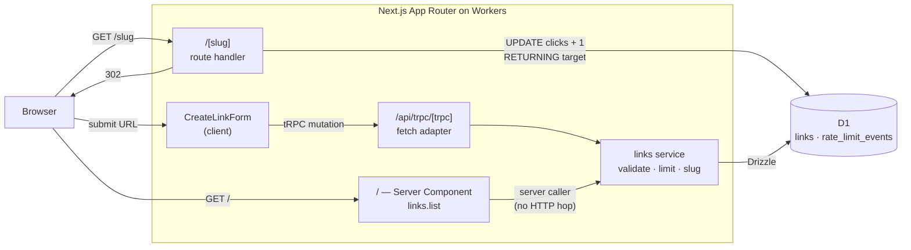
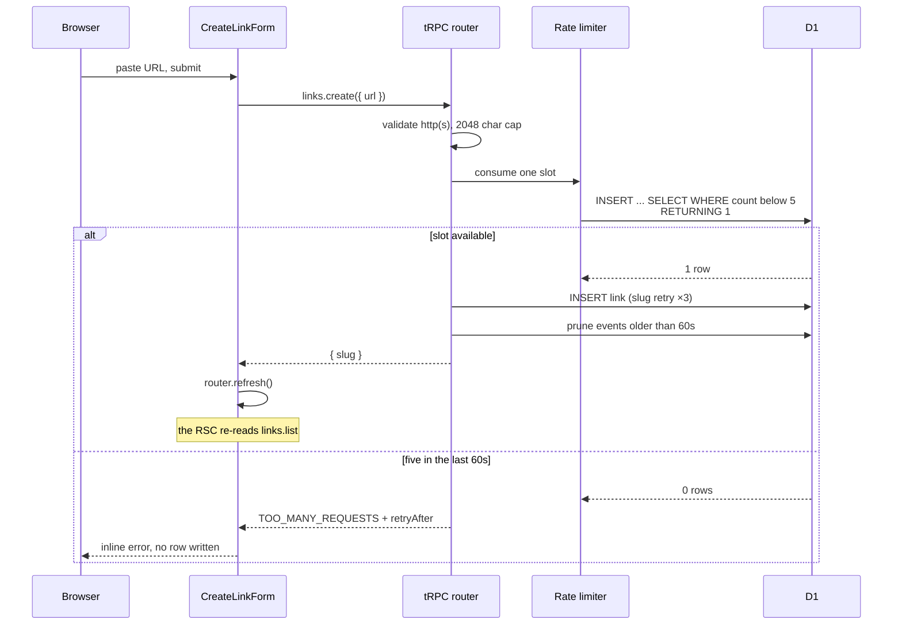

# Link shortener

A minimal link shortener built for Cloudflare Workers: Next.js App Router, tRPC, Drizzle, D1.
Create a short link, list your links, visit a slug to redirect and count the click, and stay
under 5 creations per rolling minute.

The interesting part is the edge constraints: no long-lived process, no shared in-process
memory, and no timers between requests. The rate limiter and the click counter are therefore
decided in single SQL statements, not in JavaScript.

## Architecture at a glance



Three request paths matter. The list is rendered on the server and never ships a data-fetching
client. The redirect is a route handler, not a page, so it can increment and redirect in one
round trip. The only client-side JavaScript that touches the network is the create form.

## Requirements

- Node.js 20+
- pnpm 10+

## Run

```bash
pnpm install
pnpm db:migrate   # applies migrations/0001_init.sql to the local D1 database
pnpm dev          # http://localhost:3000
```

`pnpm db:migrate` writes to `.wrangler/state/v3/d1` (gitignored), so a clean clone works without
any cloud account. `user_demo` is the current user; auth is out of scope.

## Scripts

| Command | What it does |
|---|---|
| `pnpm dev` | Next.js dev server with the OpenNext D1 binding |
| `pnpm db:migrate` | Apply migrations to the local D1 database |
| `pnpm test` | Vitest in workerd against a real D1 binding |
| `pnpm typecheck` | `tsc --noEmit` |
| `pnpm lint` | ESLint |
| `pnpm build` | Production Next.js build |
| `pnpm deploy` | Build and deploy with OpenNext (needs a real D1 `database_id`) |

## How it works

- **Create:** `links.create` validates the URL (http/https only, max 2048 chars), consumes one
  rate-limit slot with an atomic conditional `INSERT`, generates a 7-character slug, and inserts
  the row. Slug collisions retry up to three times.
- **List:** the Server Component calls the tRPC router through a server-side caller — no HTTP hop
  — and renders the table. The page is `force-dynamic`, so it reads per request. The client form
  calls `router.refresh()` after a successful mutation.
- **Redirect:** `GET /[slug]` validates the slug shape, runs one `UPDATE … SET clicks = clicks + 1
  … RETURNING target_url`, and redirects with `302`. Not `301`: a permanent redirect is cached by
  the browser and click counting stops.
- **Rate limit:** a sliding-window log, 5 successful creations per rolling 60 seconds per user.
  The count and the insert are one statement, so there is no read-then-write race. Rejected
  attempts write nothing, and validation runs before the limiter so bad input never burns quota.

### Create request



## Tests

`pnpm test` runs the ship set from `docs/TEST-PLAN.md` inside workerd with a real D1 binding:
URL policy, slug shape, the 6th-attempt rejection, no row on rejection, create shape, invalid
input not consuming quota, both 404 paths, and the redirect increment. Further cases are designed
in the plan and marked as not run.

## Deploy

The committed `wrangler.jsonc` has a placeholder `database_id`. To deploy:

```bash
pnpm exec wrangler d1 create gww-links
# replace database_id in wrangler.jsonc with the printed id
pnpm exec wrangler d1 migrations apply DB --remote
pnpm deploy
```

## Docs

- `docs/SPEC.md` — scope, data model, behaviour rules, user flows, component split
- `docs/TEST-PLAN.md` — ship set, deferred cases, and what the suite deliberately does not cover
- `docs/ARCHITECTURE.md` — Workers/D1 assumptions, rejected limiter designs, scale-up thresholds
- `docs/DECISIONS.md` — corrections made to AI-assisted output, with verification

## Deliberate limits

No auth, no custom slugs, no edit/delete, no pagination (the list shows the latest 50), no
queues/Redis/Durable Objects, no edge caching, no URL safety scanning. Each has a documented
threshold or upgrade path in `docs/ARCHITECTURE.md`; none is justified at this volume.
