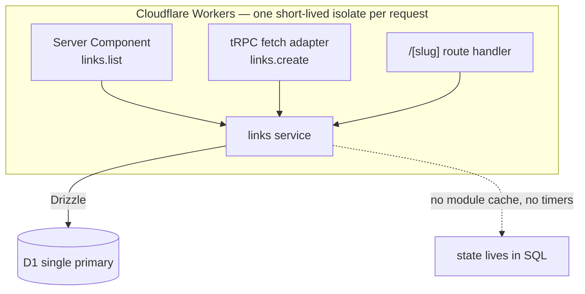
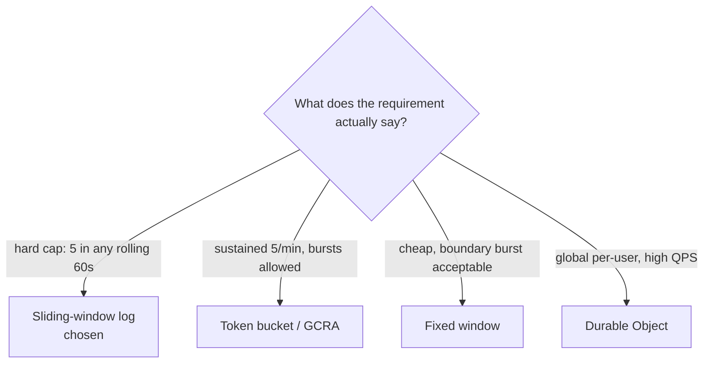
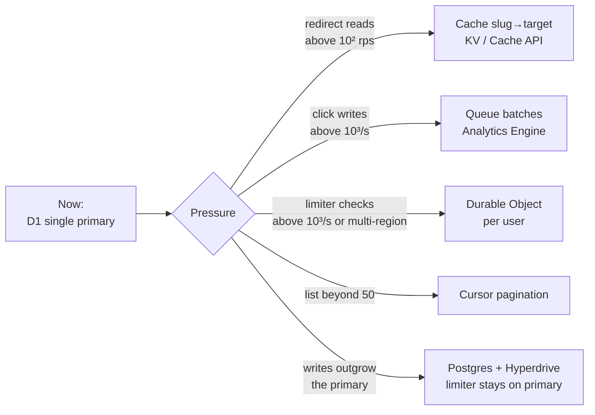

# Architecture

## Runtime shape

Every request is short-lived and may run in a different isolate. There is no in-process cache,
no module-level counter, and no `setInterval`. The DB client is created per request from the D1
binding; all coordination that must survive a request lives in SQL.



## D1 semantics this design relies on

- D1 is a single-primary SQLite database. Writes are serialized on that primary.
- A single statement is atomic. There are no interactive transactions across HTTP requests, so
  the design avoids read-then-write sequences.
- The rate limiter's `COUNT` and `INSERT` are in the **same statement**. SQLite takes the write
  lock before evaluating the subquery, so there is no gap for a concurrent request to slip
  through. This is the reason the limiter is not a JavaScript read-modify-write.
- The click counter is one `UPDATE … clicks + 1 … RETURNING`; concurrent redirects serialize and
  the count does not lose updates.
- Consequence: the limiter is correct as long as writes are serialized. If this ever moved to a
  multi-primary or eventually-consistent store, the limiter would need a Durable Object (or a
  Redis Lua script) to keep the same guarantee. That is the honest caveat behind "it's atomic".

```mermaid
sequenceDiagram
  participant A as Request A
  participant B as Request B
  participant DB as D1 primary

  A->>DB: INSERT ... SELECT WHERE count below 5 RETURNING 1
  Note over DB: write lock held;<br/>COUNT and INSERT evaluate together
  DB-->>A: 1 row → allowed
  B->>DB: INSERT ... SELECT WHERE count below 5 RETURNING 1
  Note over DB: sees A's committed row
  DB-->>B: 0 rows → rejected
```

## Limiter designs considered

| Design | Why not here |
|---|---|
| In-memory `Map` | Per-isolate and reset on eviction; provides no global limit on Workers |
| Cloudflare Rate Limiting binding | Per-colo counters; undercounts when traffic spreads across colos |
| KV | Eventually consistent; no atomic increment |
| Upstash / Redis | Correct and fast, but an extra dependency and network hop at a volume that does not need it |
| Fixed window | A 60 s bucket permits 10 creations across a boundary (5 at 0:59, 5 at 1:00) |
| Token bucket / GCRA | Permits a 6th inside the same minute: capacity 5 drains at t=0, one token refills at t=12 s. It enforces a sustained rate, not a rolling cap |
| Durable Object | The right upgrade for high volume or multi-region; extra infrastructure for 5 creations/min |

Chosen: sliding-window log in D1. Rejected attempts insert nothing, so a user has at most five
rows in the window and the count touches at most five index entries. Lazy cleanup on success
keeps the table at roughly 5 rows per active user with no cron.



## Click counting

The redirect awaits one atomic increment before responding, trading a few milliseconds for exact
counts. Alternatives: `waitUntil` fire-and-forget (faster redirect, best-effort counts) or
queue-batched events (the option above ~10³ writes/s, or when a link goes viral and the single
row becomes a contention point). Because the redirect currently reads the target in the same
statement that increments it, there is no cache in front; adding one would move counting to a
queue or analytics pipeline.

## Scale thresholds

| Pressure | Change |
|---|---|
| Redirect reads > ~10² rps | Cache slug → target in Cloudflare KV/Cache API; move counting to a queue/Analytics Engine |
| Click writes > ~10³/s | Batch increments via Cloudflare Queues; stop updating the hot row synchronously |
| Rate-limit checks > ~10³/s or multi-region | Durable Object per user (token bucket with alarms) or Upstash sliding window |
| D1 write throughput or region latency | D1 read replication for list reads; Postgres + Hyperdrive if writes outgrow a single primary. The limiter must keep hitting the primary |
| Listing beyond 50 rows | Cursor pagination on `(created_at, id)`; the current index already supports it |



## What is intentionally absent

Auth, custom slugs, edit/delete, URL safety scanning, and deployment are out of scope for the
exercise. The redirect is an open redirect by product definition; a production shortener would
add a phishing blocklist and an async scan before activating a link.
